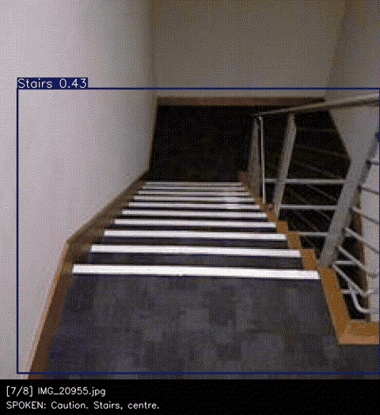

# Vision Assist MVP

Experimental assistive-vision prototype: a YOLOv8n obstacle detector trained on the ROD
dataset, a rule-based alert prioritiser, and offline spoken alerts, packaged as a
reproducible image-to-video demo.

> **Not a navigation aid.** This prototype processes still images. It has no live camera
> support, does not estimate distance, does not give directions, and has not been
> evaluated for safety or tested with users. Do not rely on it to move around.

## Demo



**▶ Video with speech: [`results/demo/vision_assist_demo.mp4`](results/demo/vision_assist_demo.mp4)**
(29.7 s). Also in that folder: the audio track ([`vision_assist_demo.wav`](results/demo/vision_assist_demo.wav)),
the [transcript](results/demo/transcript.txt) and the per-frame details
([`demo_results.json`](results/demo/demo_results.json)). GitHub shows the GIF inline; to hear
the audio, download the MP4 from its page.

The video was generated on Kaggle on 2026-10-13 by `notebooks/Vision_Assist_V2_Voice_Demo.ipynb`,
using 8 real ROD **validation** images listed in [`configs/demo_images.txt`](configs/demo_images.txt):
six scenes containing several hazards, plus one stairs image and one manhole image. They were
chosen by `scripts/select_demo_images.py` from **ground-truth labels only**, never from model
output, so the demo shows the model's misses as well as its hits. Comparing labels with
detections across the 8 images: 5 labelled hazards were missed, and there were no false-class detections.

| # | Spoken alert | Notes |
|---|---|---|
| 1 | "Caution. Car, centre. Tree, left." | The labelled **motorcycle was missed**. Person and pole were detected but not spoken (2-alert limit) |
| 2 | "Caution. Bus, centre." | The labelled **truck was missed** |
| 3 | "Caution. Motorcycle, right. Tree, centre." | |
| 4 | "Caution. Motorcycle, left." | |
| 5 | "Person, right. Crosswalk, centre." | The labelled **car was missed** |
| 6 | "Tree, centre. Tree, left." | The labelled **car and motorcycle were missed**. Trees outrank 5 pedestrians because their boxes are bigger (see limitations) |
| 7 | "Caution. Stairs, centre." | Detected at confidence 0.43, just above the 0.35 threshold |
| 8 | "Caution. Manhole, centre." | |

## Results at a glance

| | Value | Evidence |
|---|---|---|
| ROD **test** mAP50 / mAP50-95 (1,629 images) | **0.913 / 0.746** | `results/rod_yolov8n_50ep_test/metrics_test.json` |
| ROD test precision / recall | 0.902 / 0.845 | same |
| ROD validation mAP50 / mAP50-95 (3,511 images) | 0.907 / 0.726 | `results/rod_yolov8n_50ep/metrics.json` |
| Automated tests | 45 passed, 0 failed (locally and on Kaggle) | `pytest -q` |
| CPU inference per image (640 px) | ~100–160 ms (mean 146 ms in the Kaggle demo run) | `results/demo/demo_results.json` → `latency` |

The scores are object-detection accuracy on the ROD dataset. They do not measure how safe or
useful the spoken alerts are.

## What it does

```
images ──▶ detector.py ──▶ guidance.py ──────────▶ speech.py ──▶ demo.py
           YOLOv8n          tier + image region     eSpeak NG      frames, WAV, MP4,
           (existing        top-2 per frame,        offline TTS    transcript, JSON
            checkpoint)     6 s repeat cooldown                    with latency
```

| Module | Responsibility |
|---|---|
| `vision_assist/detector.py` | Loads the existing checkpoint, returns plain `Detection` objects plus an annotated frame |
| `vision_assist/guidance.py` | Pure rules: hazard tier per class, image third (left/centre/right), ranking, wording, repeat suppression |
| `vision_assist/speech.py` | eSpeak NG synthesis with timeouts and errors, plus WAV timeline assembly |
| `vision_assist/demo.py` | CLI and `run_demo()`: writes all outputs and per-stage latency |
| `vision_assist/config.py` | Path resolution: CLI flag, then environment variable, then default (no Kaggle-only paths) |

### Alert rules (`guidance.py`)
- **High tier:** stairs, manhole, car, motorcycle, bike, truck, bus. These are prefixed with "Caution."
- **Medium tier:** people, dogs, poles, cones, barrels, bins, benches, other street furniture.
- **Low tier:** crosswalk, traffic sign. **Ignored:** road, building (present in almost every frame).
- One alert per (class, image third). Order is tier first, then larger box, then confidence. At most **2** alerts are spoken per frame.
- The same (class, image third) is not repeated within **6 s**. A hazard that persists is re-announced after the cooldown.
- A lower-tier alert never takes the place of a higher-tier hazard that is being held back as a repeat. Without this rule, "Tree, right." was spoken alone while a motorcycle was in view (ROD test image IMG_20590).
- If nothing is detected, nothing is spoken. The system **never says "clear"**.
- "left/centre/right" is the third of the *image* that the box centre falls in. It is not a
  direction and assumes nothing about where the camera points. Box size is used only for
  ranking. It is **not** a distance estimate.

## Quick start

### Kaggle
1. Create a notebook from `notebooks/Vision_Assist_V2_Voice_Demo.ipynb`.
2. Use *Add Input* to attach `abtinzandi/obstacle-detection-dataset` (ROD), and enable Internet.
3. Run all cells. The notebook clones this repo (`BRANCH = "main"` by default), installs
   `requirements.txt` plus `espeak-ng` and `ffmpeg`, runs the tests, then builds the demo from
   `configs/demo_images.txt` into `outputs/demo/`. Set `IMAGE_LIST = None` to use the first 8
   validation images instead.

### Local (Linux/macOS)
```bash
git clone https://github.com/SudhaMsr/VisionAssist-MVP.git && cd VisionAssist-MVP
python3.12 -m venv .venv && . .venv/bin/activate
# optional, CPU-only machines: pip install torch torchvision --index-url https://download.pytorch.org/whl/cpu
pip install -r requirements.txt
sudo apt-get install -y espeak-ng        # macOS: brew install espeak-ng
pytest -q
# Same demo as above (needs the ROD dataset downloaded from Kaggle):
python -m vision_assist.demo --images /path/to/ROD-Dataset/dataset/valid/images \
    --image-list configs/demo_images.txt --out outputs/demo
```
Without ROD, `--images "$(python -c 'import ultralytics,pathlib;print(pathlib.Path(ultralytics.__file__).parent/"assets")')"`
runs on the two sample photos bundled with Ultralytics. These photos are out-of-domain and only show that the pipeline works.

Configuration: `--model`/`VISION_ASSIST_MODEL`, `--images`/`VISION_ASSIST_IMAGES`,
`--out`/`VISION_ASSIST_OUTPUT`, `--tts`/`VISION_ASSIST_TTS`. See `python -m vision_assist.demo -h`
for thresholds, alert count and cooldown.

### Outputs (`outputs/demo/`, git-ignored)
| File | Contents |
|---|---|
| `frames/frame_NN.jpg` | Annotated image with a caption strip: what was spoken and what was suppressed |
| `vision_assist_demo.wav` | All alerts on one timeline. Each frame's slot is at least 2 s and stretches to fit its speech |
| `vision_assist_demo.mp4` | H.264 and AAC. Frames held for their slot duration, in sync with the WAV |
| `transcript.txt` | Timestamped spoken text |
| `demo_results.json` | Settings, hardware, latency summary, per-frame detections and spoken/suppressed alerts |

## Known limitations
- **Still images only.** No camera capture, tracking or temporal smoothing. No distance,
  depth, direction or path-clearance reasoning. Not safety-validated and not tested with users.
- **The detector misses objects.** In the demo it missed 5 labelled hazards across 4 of the 8 images:
  a motorcycle (frame 1), a truck (frame 2), a car (frame 5), and a car and motorcycle (frame 6). On Ultralytics' out-of-domain `bus.jpg` it missed a large bus even at
  confidence 0.1. The rule engine cannot recover a missed detection.
- **Ranking is by class and box size only.** Trees can outrank pedestrians (demo frame 6),
  and a parked motorcycle outranks a person walking toward the camera (ROD test IMG_20595).
  The system cannot tell moving objects from stationary ones. The tiers are hand-written
  heuristics.
- **Accuracy is known only on ROD.** Performance on other imagery, such as a phone camera at
  walking height, has not been measured.
- The checkpoint's class names include a dataset typo (`Teraffic Barrel`). It is kept as-is so
  the labels match the weights, and it is spoken as "traffic barrel".

## Verification details
- **Detector:** YOLOv8n at 640 px, 50 epochs, seed 42. Test metrics were measured on Kaggle with
  `scripts/evaluate_checkpoint.py`, using the same label preparation as training (1,957 boxes and
  415 polygons converted, 0 skipped). Test mAP50 for the high-tier classes: stairs 0.888,
  manhole 0.950, car 0.896, bus 0.881, motorcycle 0.880, truck 0.885, bike 0.963. Person scores
  0.873. The weakest classes are road (0.718, ignored by the alert rules) and dustbin (0.781).
  Test agrees with validation, so there is no evidence on ROD that retraining is needed.
- **Class names:** the dataset's own `data.yaml`, the checkpoint and `configs/rod_detection.yaml`
  list the same 25 classes in the same order.
- **Notebook on Kaggle (2026-10-13):**
  - From `main` with the default `BRANCH = "main"`: completed, 43 of 43 tests passed (before this
    milestone's 2 new tests), and produced a 20.2 s MP4 on the first 8 validation images.
    A record of that earlier run is in `results/voice_demo_v2_kaggle/`.
  - With the curated image list: completed, 45 of 45 tests passed, and produced
    `results/demo/`. In both runs the MP4 decodes with no errors, and speech is present in
    exactly the slots that have an alert.
- **Multi-hazard check on ROD test images** (IMG_20581–20597): this run found the
  tier-replacement flaw now handled by the alert rules. Its record is in
  `results/voice_demo_v2_rod_multi_hazard/`.
- **Local runs:** WSL2 Linux, Python 3.12, CPU-only PyTorch, ultralytics 8.4.175, espeak-ng 1.52.
  Latency figures come from single CPUs, are not real-time claims, and exclude camera capture and
  audio playback.
- The old README figure (mAP50 0.6746) came from a one-epoch smoke run
  (`models/rod_baseline_smoke_best.pt`) and is superseded.

## Repository layout
```
vision_assist/        reusable package (detector, guidance, speech, demo CLI)
tests/                pytest suite (fake TTS engine + real-model smoke tests)
scripts/
  evaluate_checkpoint.py   test/valid-split evaluation (same label prep as training)
  select_demo_images.py    regenerates configs/demo_images.txt from ROD labels
configs/
  demo_images.txt          the 8 demo images, in playback order
  rod_detection.yaml       class names + dataset layout used for training
notebooks/
  vision-assist-v1.ipynb              executed training + validation run (source of metrics)
  Vision_Assist_V2_Voice_Demo.ipynb   demo runner (Kaggle or local)
models/               rod_yolov8n_50ep_best.pt (used), rod_baseline_smoke_best.pt (1-epoch smoke)
results/
  demo/                            the current demo (MP4, WAV, GIF, transcript, JSON)
  rod_yolov8n_50ep/                validation metrics, curves, confusion matrices
  rod_yolov8n_50ep_test/           test-split metrics
  voice_demo_v2_kaggle/            earlier Kaggle run (first 8 validation images)
  voice_demo_v2_rod_multi_hazard/  multi-hazard test-image check
archive/              superseded scratch notebook and legacy demo (see archive/README.md)
```

Dataset images are not included. ROD is obtained separately from Kaggle.
